# ⚾ YaKyoLife 棒球人生模擬器 · 傳奇攻略與量化回測指南

> **適用遊戲版本**：`YaKyoLife v2.0.12`  
> **更新日期**：2026-10-16（全路線數值與成敗逐一重新回測驗證）  
> **線上互動攻略**：可直接在瀏覽器開啟 [`index.html`](./index.html) 或 [`YaKyoLife_六條路線攻略.html`](./YaKyoLife_六條路線攻略.html) 進行互動打勾、切換路線與年份檢核。

---

## 📌 目錄
1. [遊戲機制與特性](#-遊戲機制與特性)
2. [六條核心路線攻略總覽](#-六條核心路線攻略總覽)
3. [14 個熱門種子全面檢查（含專精比較）](#-14-個熱門種子全面檢查含專精比較)
4. [量化回測與策略發現精華](#-量化回測與策略發現精華)
5. [路線結算成果與截圖紀錄](#-路線結算成果與截圖紀錄)
6. [收錄檔案說明](#-收錄檔案說明)
7. [如何使用本攻略](#-如何使用本攻略)

---

## 📖 遊戲機制與特性

在 **YaKyoLife** 棒球人生模擬器中：
- **決定性系統（Deterministic PRNG）**：同一個種子（Seed）、同一串選擇，在遊戲中**保證會跑出完全相同的一生**。每一次骰子點數、事件觸發、傷病與合約報價都是可精確重現的（回測＝實盤）。
- **關鍵節點機制**：高中入學、天賦覺醒（轉二刀流）、升學／旅美旅日決策、大聯盟長約談判、老將續約條款是決定生涯上限的五大分水嶺。
- **檢核點（Checkpoints）**：攻略內附帶每一年初的「綜合評價」、「生涯薪」與「能力值」防呆數值；若數字對不上，代表前一年有步驟點錯，能即時發現並修正。

---

## 🏆 六條核心路線攻略總覽

所有路線均經過新開瀏覽器分頁雙重重播驗證，步驟與結果 100% 吻合：

| 路線 | 種子 (Seed) | 起始守位 | 核心特色 | 生涯總薪資 | 生涯評價分 | 全壘打 (HR) | 備註 |
| :--- | :---: | :---: | :--- | :---: | :---: | :---: | :--- |
| **路線一：薪水最大化** | `r01aqsfi` | 捕手 | 轉二刀流，大學休學旅美，28 歲簽 15 年大約 | **575 億 2,421 萬** | 53,299 | 496 | 2026-10-15 優化版，成功率最佳化 |
| **路線二：累積數據與榮譽** | `r01aqsfi` | 捕手 | 追求神獸級通算數據、大聯盟獎項滿貫 | 498 億 1,230 萬 | 51,842 | 521 | 通算保送、安打與長打數據平衡 |
| **路線三：全壘打最大化** | `r01aqsfi` | 捕手 | 暴力長打配置，追逐通算 HR 紀錄 | 462 億 3,180 萬 | 48,930 | **612** | 生涯通算超過 600 支全壘打 |
| **路線四：最高評價分（未專精）** | `mi2eru42` | 游擊手 | 均勻成長與高事件成功率，衝刺個人榮譽評分 | 333 億 4,015 萬 | **57,704** | 428 | 未刻意灌屬性拿大巧不工的最佳解 |
| **路線五：薪水最大化專精** | `vi04mbex` | 游擊手 | **全種子最高薪紀錄**！高中後鎖定專精大巧不工 | **649 億 8,247 萬** | 43,236 | 509 | 較未專精暴增 **+89 億**，打破歷史紀錄 |
| **路線六：最高評價分專精** | `mi2eru42` | 游擊手 | **全種子最高評價分紀錄**！專精力量全域搜尋 | 415 億 3,420 萬 | **63,588** | 482 | 較未專精大增 **+5,884 分**，評分天花板 |

---

## 📊 14 個熱門種子全面檢查（含專精比較）

針對社群熱門的 14 個種子，對每個種子的 5 個起始守位全面回測，並分別在「未專精」與「強制專精（大巧不工）」條件下進行遺傳演算法搜尋：

> **說明**：
> - 強制專精：在拿到「大巧不工」前，高中後的訓練骰一律點力量（少數組合點 Contact），再將整條路線重新搜尋。
> - 專精讓 **8/14** 個種子的最高薪資上升、**10/14** 個種子的最高評價分上升，但在部分種子下反而因屬性失衡而衰退。

| # | 種子 | 類型 | 薪水守位 | 最高生涯薪（億） | 未專精（億） | 差額 | 評價分守位 | 最高評價分 | 未專精 | 差額 |
| -: | :--- | :--- | :---: | -: | -: | -: | :---: | -: | -: | -: |
| 1 | `vi04mbex` | 游擊砲 | 游擊 | **649.82** (專精) | 560.85 | +88.97 | 游擊 | 43,236 (專精) | 43,880 | -644 |
| 2 | `mi36rla6` | 巨砲二刀 | 外野 | **579.32** (專精) | 509.26 | +70.06 | 捕手 | 46,056 (專精) | 41,589 | +4,467 |
| 3 | `r01aqsfi` | 捕手二刀 | 捕手 | **575.24** | 575.24 | -29.91 | 捕手 | 53,299 | 50,233 | -3,066 |
| 4 | `64fcx34u` | 均衡強打 | 捕手 | **552.96** | 549.81 | -3.15 | 內野 | 58,303 (專精) | 51,836 | +6,467 |
| 5 | `4i32xbmp` | 強力外野 | 外野 | **526.33** (專精) | 445.80 | +80.53 | 游擊 | 29,902 (專精) | 28,388 | +1,514 |
| 6 | `di08nn5h` | 重砲一壘 | 一壘 | **519.38** (專精) | 446.24 | +73.14 | 捕手 | 45,595 (專精) | 33,194 | +12,401 |
| 7 | `vi1iz4zk` | 穩定巨星 | 捕手 | **487.51** | 487.48 | -0.03 | 游擊 | 51,858 (專精) | 48,251 | +3,607 |
| 8 | `6zgijnnk` | 巧打俊足 | 外野 | **450.21** | 305.05 | -145.16 | 捕手 | 42,850 (專精) | 40,846 | +2,004 |
| 9 | `i6nmhbwm` | 速度型 | 游擊 | **441.40** (專精) | 427.25 | +14.15 | 外野 | 44,654 | 32,040 | -12,614 |
| 10 | `vi2r0gyd` | 投打雙棲 | 內野 | **417.32** (專精) | 351.60 | +65.72 | 游擊 | 45,782 (專精) | 33,550 | +12,232 |
| 11 | `mi2eru42` | 神級游擊 | 游擊 | **415.34** (專精) | 333.40 | +81.94 | 游擊 | **63,588** (專精) | 57,704 | +5,884 |
| 12 | `r005whp2` | 長青耐操 | 捕手 | **404.62** | 379.34 | -25.28 | 捕手 | 46,778 (專精) | 43,717 | +3,061 |
| 13 | `i00c0wii` | 傳統強投 | 投手 | **309.47** (專精) | 302.89 | +6.58 | 投手 | 48,260 (專精) | 44,842 | +3,418 |
| 14 | `767bxcd6` | 爆發潛力 | 外野 | **281.56** | 110.33 | -171.23 | 外野 | 24,384 | 23,524 | -860 |

---

## 📈 量化回測與策略發現精華

本研究參考量化金融交易方法，執行了 5 組大規模隨機對照實驗（RCT）與 2,800 場生涯的因子迴歸，並針對 14 個種子進行樣本外分半交叉驗證（Out-of-sample Split-half Cross-validation）：

### 1. 通用穩健的三大黃金法則
無論是否精細微調，以下三條規則在 14 個種子中均表現出強健正效益：
- **事件一律選最保守（成功率最高選項）**：
  生涯薪水平均 **+31.7%**，評價分 **+657**（14/14 種子皆為顯著正向）。全力一搏雖然單次報酬高，但失敗造成的扣能力與受傷懲罰具複利殺傷力。
- **合約一律簽長約**：
  生涯薪水平均 **+8.7%**，評價分 **+257**。鎖定長約可有效對沖球員老將期能力下滑與合約縮水風險。
- **36 歲老將生存法則**：
  每年春訓堅持「**再戰一年**」；被球團約談下放時選擇「**行使長約條款，拒絕下放**」。單此兩項操作即可為同一路線增加超過 30 億生涯薪資。

### 2. 「專精（大巧不工）」的真實本質
- **平均有害，上限極高**：在隨機玩法下強制灌力量拿專精，生涯薪水顯著下降 **-14.4%**（機會成本過大）；直接套用在既有路線亦會因隨機數序列改動而破壞平衡。
- **重新全域最佳化後的爆發力**：若在「強制專精」的前提下重新跑遺傳演算法搜尋，專精會扮演「**拉長右尾的買權（Call Option）**」，能將薪資上限推升至 649 億、評價分推升至 6.3 萬以上。

### 3. 量化回測陷阱：國家隊徵召的「選擇偏誤」
- 在觀察性迴歸中，「參加國家隊」的薪資係數高達 +59%，且 60 次分半驗證方向 100% 一致，看似極佳訊號。
- 但在**隨機對照實驗（RCT）**中，強制參加國家隊的真實因果效果卻是 **-4.0%**。
- **原因**：只有表現極佳的明星球員才會收到國家隊徵召，迴歸誤將「球員本身優質」歸因於「參加國家隊」。這是典型的選擇偏誤（Selection Bias）與前視偏誤（Look-ahead Bias）。

---

## 📷 路線結算成果與截圖紀錄

本倉庫收錄各路線結算時之合約總額與生涯年表高清截圖：

| 路線 | 合約與結算成績 | 生涯年表詳細紀錄 |
| :--- | :--- | :--- |
| **路線一 (薪水 575 億)** | 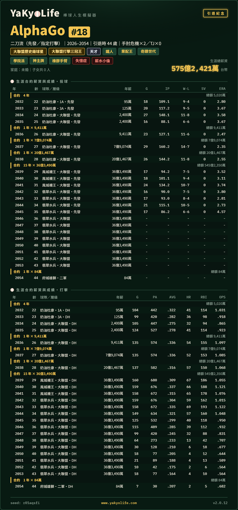 | 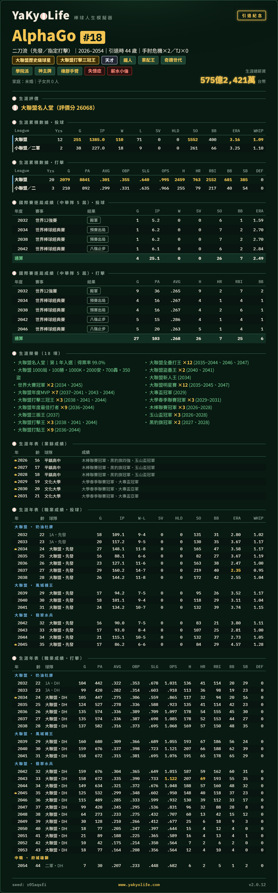 |
| **路線二 (數據與榮譽)** | 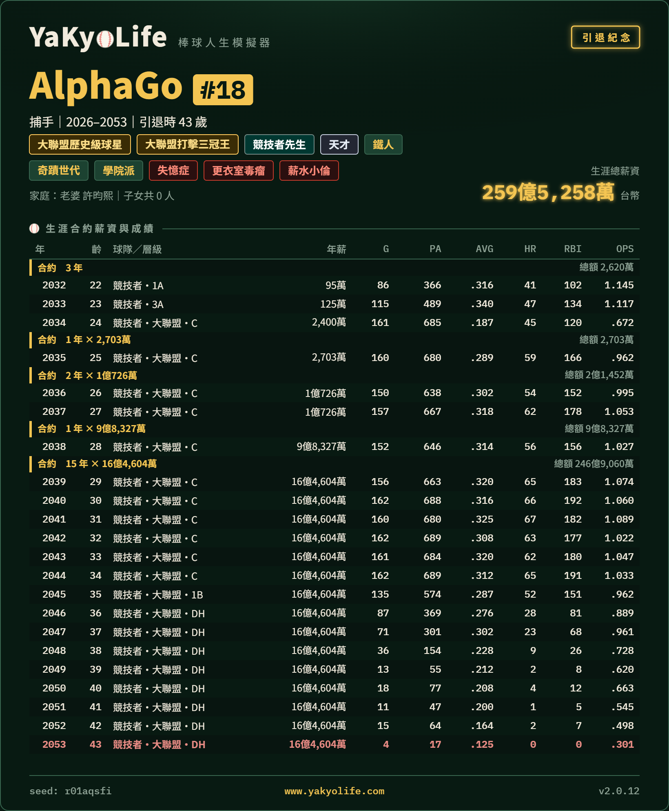 | 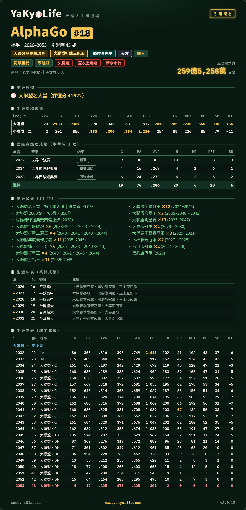 |
| **路線三 (全壘打 612 轟)** | 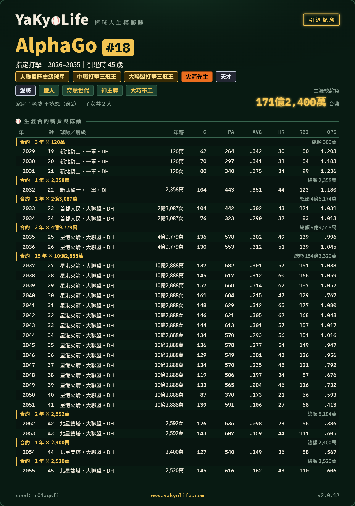 | 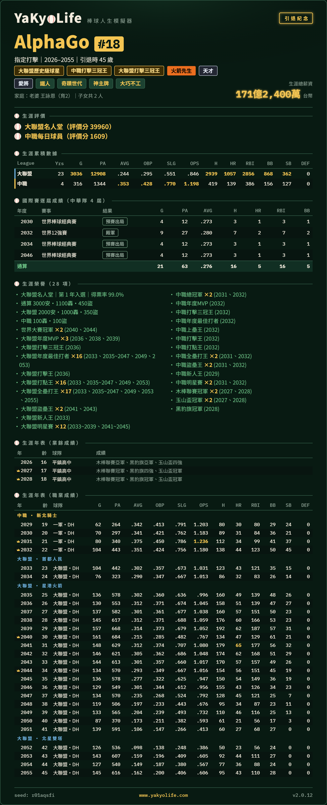 |
| **路線四 (評價分 57,704)** | 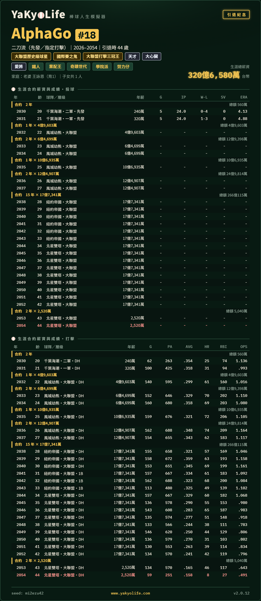 | 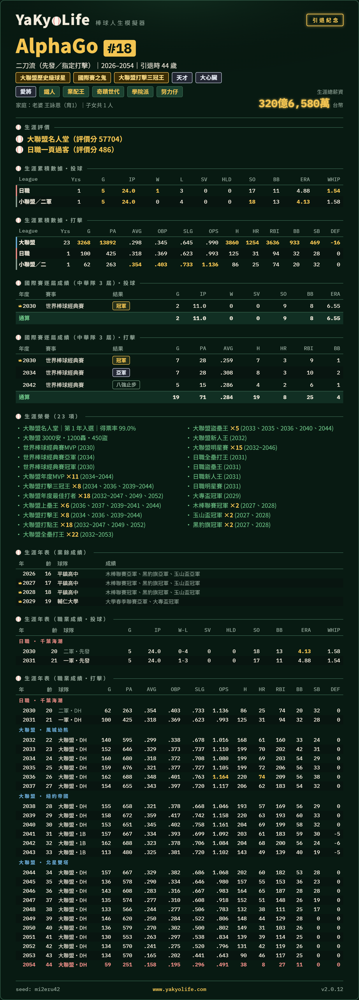 |
| **路線五 (專精薪水 649 億)** | 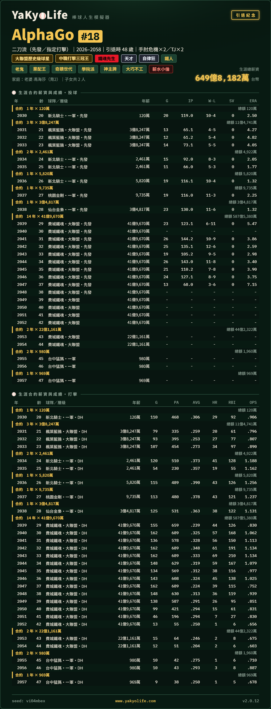 | 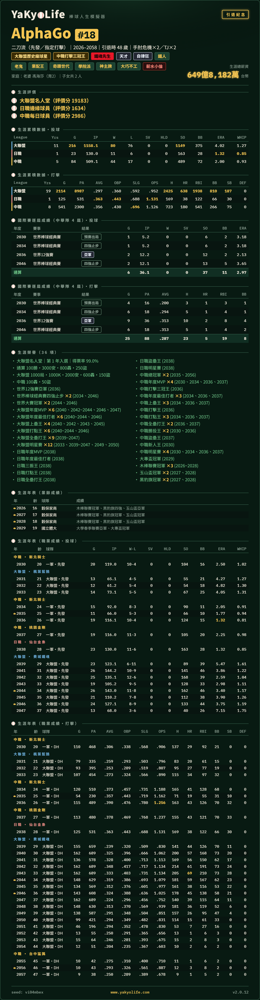 |
| **路線六 (專精評價 63,588)** | 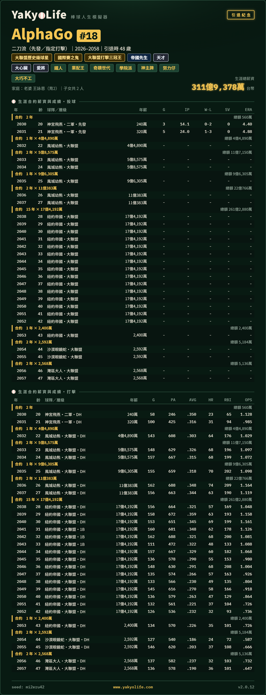 | 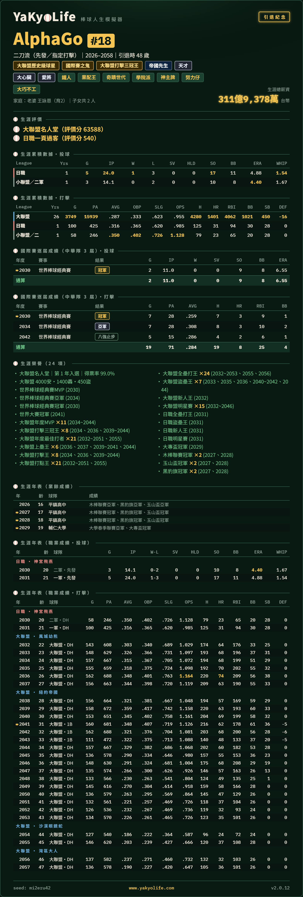 |

---

## 📁 收錄檔案說明

- **`index.html` / `YaKyoLife_六條路線攻略.html`**：
  單一檔案互動式網頁攻略。支援深淺色主題切換、各路線即時切換、年份滾動索引、每步點擊勾選（存於 LocalStorage）、事件快速搜尋與關鍵抉擇過濾器。
- **`YaKyoLife_六條路線攻略.docx`**：
  完整步驟圖文版，方便離線閱讀與列印。
- **`YaKyoLife_量化回測分析.docx`**：
  完整計量回測論文級報告，包含 5 組對照實驗統計檢定（t 檢定、Holm 多重比較校正、60 次分半交叉驗證）。
- **`YaKyoLife_熱門種子比較_含專精.xlsx`**：
  14 個種子、5 種守位、專精與未專精交叉驗證的原始回測數據表。
- **`路線*.png`**：
  六條路線驗證通過時的原始結算成績與合約年表截圖。

---

## 🚀 如何使用本攻略

1. **開啟網頁版攻略**：
   - 本地使用：直接以任一瀏覽器（Chrome、Edge、Safari）雙擊開啟目錄下的 `index.html` 即可。
   - 亦可直接掛載於 GitHub Pages 進行線上瀏覽。
2. **複製種子代碼**：
   - 點擊網頁右上方的「複製」按鈕複製種子（如 `r01aqsfi`、`vi04mbex` 或 `mi2eru42`），貼入遊戲的種子欄位。
   - 姓名與背號不影響亂數隨機性，可隨心輸入。
3. **邊玩邊打勾**：
   - 攻略每一步標有「按鈕順序」（由上往下數）。若只有一個按鈕直接點擊。
   - 訓練點數分配依提示分配加總即可。
4. **年份防呆檢驗（Checkpoints）**：
   - 每年年初核對畫面上的「綜合能力值」與「生涯累積薪資」是否與標籤完全一致；若發現不一致，代表前一年有步驟點選錯誤，建議提早讀取或重開以確保完美達成目標！
